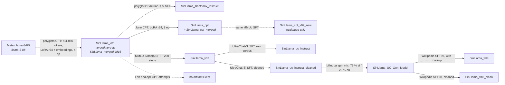

# SinLlama: research history, Feb–Sep 2026

This document covers the SinLlama continual-pretraining and instruction-tuning project:
- what was tried, in what order, and why;
- how every model in `gs://sinllama_cpt` was trained;
- what the evaluations show.

**Status as of 2026-10-11.** The last project activity was on 2026-09-30, when `SinLlama_wiki_clean` was uploaded.
Companion page (same content, with diagrams): <https://claude.ai/artifact/YJUap1Gxutt17X2Uvsd53P>.

**Sources**
- The git history: 293 commits, 2026-02-06 → 2026-09-29.
- The bucket `gs://sinllama_cpt`: 231 GiB, 3,331 objects.
- W&B entity `thisen-ekanayake`: projects `sinllama-cpt`, `sinllama-sft-mmlu`, `sinllama-sft-uc`, `sinllama-finetune`, `sinllama-classification` and `sinllama-news-classification`.
- The Hugging Face Hub.
- The existing docs in `docs/`.

Nothing was re-run for this document. Every number comes from a saved result, log, checkpoint or run record. **(inferred)** marks a conclusion drawn from indirect evidence. Times are UTC unless marked +0530.

## Contents

1. [Summary](#1-summary)
2. [Corrections to earlier write-ups](#2-corrections-to-earlier-write-ups)
3. [Model family tree](#3-model-family-tree)
4. [How the project unfolded](#4-how-the-project-unfolded)
5. [Model cards](#5-model-cards)
6. [Training recipes side by side](#6-training-recipes-side-by-side)
7. [Datasets](#7-datasets)
8. [Evaluation](#8-evaluation)
9. [Side investigations](#9-side-investigations)
10. [Compute and infrastructure](#10-compute-and-infrastructure)
11. [Open questions](#11-open-questions)
12. [Suggested next steps](#12-suggested-next-steps)
- [Appendix A. GCS inventory](#appendix-a-gcs-inventory)
- [Appendix B. W&B run index](#appendix-b-wb-run-index)
- [Appendix C. Repo map](#appendix-c-repo-map)

---

## 1. Summary

**Goal.** The starting point is SinLlama_v01, the polyglots group's Sinhala adaptation of Llama-3-8B, which extends the vocabulary by 11,080 Sinhala tokens. The project set out to:
1. continue pretraining it on a new Sinhala corpus;
2. turn the result into a Sinhala instruction-following chat model;
3. measure what each step gains in Sinhala and loses in English.

**Where it stands**
- The bucket holds **ten full models**:
  - three external: Llama-3-8B, SinLlama_v01 and Bactrian-X Instruct;
  - one continual-pretraining (CPT) model, `SinLlama_cpt`;
  - one task-format SFT model, `SinLlama_v02`;
  - five chat models in a single lineage: `uc_instruct`, then `uc_instruct_cleaned` → `UC_Gen_Model` → `wiki` / `wiki_clean`.

  Nine of them also have task adapters for the three downstream classification tasks.
- The latest chat models stop cleanly at the end of a turn. They no longer have the corpus artifacts that spoiled the first version. Since the gen stage they also answer English in English.
- No model in the chat line has had a proper generation-quality evaluation.

**Main findings**

1. **The new CPT did not improve on v01.**
   - `SinLlama_cpt` was trained in June: 1 epoch, LoRA r64, on a new 220 M-token corpus.
   - It scores below v01 on Sinhala MMLU: 35.7 vs 37.9 raw, 39.6 vs 41.4 debiased.
   - It scores below v01 on English MMLU: 39.4 vs 48.4 raw.
   - After downstream fine-tuning it cannot be told apart from v01.
   - The two earlier CPT attempts (February on an A40, April on an MI300X) left no artifacts.
   - **(inferred)** One likely reason: the CPT corpus turned out to be close to a lexical subset of v01's own pretraining corpus.
2. **`SinLlama_v02` is v01 plus a short MMLU-format SFT, not a CPT model.**
   - It was made on 2026-08-05 from about 200–300 steps of LoRA SFT on the machine-translated MMLU-Sinhala `auxiliary_train` split.
   - That data was rendered in the SinhalaMMLU evaluator's exact prompt format.
   - v02 leads v01 on Sinhala MMLU by 4.2 pp raw and 2.5 pp debiased. Part of that lead is format learning.
   - Every chat model descends from v02.
3. **Sinhala adaptation costs English.**
   - English MMLU falls from 65.5 (Llama-3-8B) to 48.4 (v01) and 51.0 (v02). Debiased, the drops are 13.5 and 11.5 pp.
   - Over the same steps, Sinhala MMLU rises by 5.4 and 9.6 pp raw.
4. **Chat SFT costs about 3 pp of Sinhala MMLU.**
   - From v02 to `uc_instruct_cleaned` the loss is 3.3 pp raw and 2.9 pp debiased (paired McNemar p ≈ 2e-7). English is roughly flat.
   - The later gen and Wikipedia stages do not move Sinhala MMLU.
5. **Data quality caused most of the chat-model defects, not the training recipe.**
   - The machine-translated UltraChat-Sinhala carried JW300/Watchtower boilerplate from the MT system: a junk word sat at the start of 99.2 % of numbered list items. The first chat model reproduced it faithfully, and rule-based cleaning removed it.
   - The same thing happened with Wikipedia link markup, present in 67 % of training rows. It leaked into `SinLlama_wiki` and was fixed in `SinLlama_wiki_clean`.
6. **Avoiding the Llama-3 chat template was the right call.**
   - That template's role tokens are untrained in SinLlama (embedding L2 ≈ 1e-21).
   - The project's `### User:` / `### Assistant:` + `<|end_of_text|>` template stops cleanly: 11/12 prompts, with mean P(EOS) 0.85 at turn ends.
   - The external Bactrian-X model never stops.
7. **On the three downstream tasks, every Sinhala-adapted model beats fine-tuned Llama-3-8B.**
   - Accuracy margins: about 2–7 pp on news, 4–9 pp on sentiment and 5–13 pp on writing style.
   - The SinLlama variants differ from each other by less than run-to-run noise. Rerunning the same config and seed in another session moved news macro-F1 by up to 3.2 pp.
8. **Several evaluation pitfalls were found and fixed along the way:**
   - an SDPA left-padding bug on ROCm that collapsed answers onto option A;
   - answer-position bias worth 1–9 pp;
   - a PIQA set too small to rank models (n = 92–95);
   - a metric bug that made early hyperparameter-search runs report 100 % accuracy.

---

## 2. Corrections to earlier write-ups

This review found the following to be wrong or misleading in files a reader may already have seen. None of them changes a model, but several change how the results should be read.

| where | what it says | what the evidence shows |
|---|---|---|
| `docs/benchmark-report.md`; `inference/models.yml:7` | v02 is presented as the strongest Sinhala adaptation; `models.yml` lists it under "Base / CPT checkpoints" | v02 = v01 + an MMLU-format SFT (`sft/run_sft_mmlu.sh:2-4`). Its MMLU lead is partly format training ([§5.4](#54-sinllama_v02-v01--mmlu-sinhala-sft)) |
| `docs/benchmark-report.md`; `benchmark/results/prior_2026-08-01/` | the base-model results are a "2026-08-01" run | they were produced on 2026-08-09/10 (GCS `results_1_08_2026/`, uploaded 2026-08-10). v02 did not exist before 08-05 |
| `docs/benchmark-report.md`, "Method" | "bf16, sdpa" | MMLU and downstream used eager attention (downstream since `a4752a8`). Only Global-PIQA used sdpa |
| `docs/benchmark-report.md`, downstream tables | single-run numbers, read as model differences | an identical-config run on 2026-08-06 (W&B; GCS `downstream_*`) differs by up to 3.2 pp in news F1 and 8.2 pp in Llama writing F1. Gaps between SinLlama variants are noise ([§8.4](#84-downstream-classification-results)) |
| `benchmark/mmlu/evaluate_{sinhala,english}_mmlu.py`, `assert_eager` docstring (`4e9a013`) | SinLlama_cpt was "re-scored at 47.27 % / 41.33 % once eager was forced" | 47.27 / 41.33 are the scores of a different checkpoint, `SinLlama_cpt_v02_new` (cpt + the MMLU SFT). cpt's eager scores are 39.4–40.1 English and 35.7 Sinhala |
| `docs/position-bias-study.md`, retraction in `8471099` | the stray cpt figures were the permuted arm (39.56 / 47.24) | they were `SinLlama_cpt_v02_new`'s. The retraction's conclusion, that the cpt row is valid, still holds |
| `docs/gen-stage.md`, "Open items" | "Not yet run" | it ran on 2026-08-22 (W&B `e3yh3pml`) and early-stopped at step 2,400 |
| `docs/uc-instruct-evaluation.md` §2 | Bactrian-X was "7,238 examples re-run 4 times at 2e-4" | that trainer log belongs to a sentiment-tagger run in the same polyglots notebook. The notebook's Bactrian-X code trains on 67,017 examples for 1 epoch. No script survives for the P(EOS) = 8e-8 figure, though the behaviour (never stopping) is confirmed |
| `results/latex/Downstream_Tasks.tex`; `results/data/downstream/new/comparison.csv` | the Sinhala checkpoints beat "the Llama-3-8B baselines by 30–50 pp on writing style" | the first six rows are copied from the SinLlama paper's Table III without being labelled as such. Against this project's own fine-tuned Llama-3-8B, the writing gap is 5.7–15.3 pp. The table also mixes June NVIDIA runs with August MI300X runs |
| `results/latex/MMLU_Benchmark.tex` vs `docs/benchmark-report.md` | (no claim) | the two take the base models from different runs and English prompt formats (July canonical vs August per-block). The differences are ≤ 0.8 pp, except Bactrian-X Sinhala at 2.6 pp (Alpaca vs raw template) |
| `results/data/README.md` | wiki MMLU was scored "(chat template)"; there is no debias run for wiki_clean | wiki's metrics files say `"format": "raw"`. Sinhala permuted and calibrated arms for wiki_clean exist in `results_29_09_2026/debias/` |
| downstream news prompt (`benchmark/downstream/finetune_news_category.py:52-57`; the SinLlama paper uses the same legend) | Political 0, Business 1, Technology 2, Sports 3, Entertainment 4 | the data encodes 0 = Business, 1 = Political, 2 = Entertainment, 3 = Sports, 4 = Technology (keyword probe, [§7.8](#78-downstream-classification-datasets)). Fine-tuning learns the data's mapping anyway, but the prompt contradicts it for 4 of the 5 classes |
| W&B `sinllama-classification` `*_s2_best` runs (Mar 2026) | eval accuracy = F1 = 1.0 | the metric read the final padding token, not the label ([§5.12](#512-downstream-classification-adapters)) |
| `sft/config.yaml:23` | `gcs_uri: gs://sinllama-cpt/...` | the bucket is `sinllama_cpt` (underscore). The same typo in `benchmark/main.yml` silently dropped benchmark uploads until `1ac80c3` |
| SinhalaMMLU paper: Llama-3-8B ≈ 22.5 % | (external claim) | this matches the "always answer 1" floor on this dataset almost exactly, so it is not a usable baseline. This project measures 32.5 % (3-shot, eager) |

---

## 3. Model family tree

- **Arrows.** A solid arrow means the weights were produced and kept in GCS. A dashed arrow means the model was trained or evaluated, but its weights were not kept.
- **Vocabulary.** Every model below Llama-3-8B uses the extended 139,336-token vocabulary.
- **Frozen embeddings.** After v01, every stage trained in this project kept `embed_tokens` and `lm_head` frozen. The evidence is the identical `lm_head` shard hashes and the July weights analysis.
- **Downstream adapters.** Nine models also received a task LoRA for each of the three downstream tasks ([§5.12](#512-downstream-classification-adapters)): llama-3-8b, v01, cpt, Bactrian-X, v02, uc_instruct_cleaned, UC_Gen, wiki and wiki_clean.

---

## 4. How the project unfolded

| phase | dates (2026) | what happened | outcome |
|---|---|---|---|
| **0 · Orientation** | Feb 6–13 | Merged Llama-3-8B with the v01 adapter in bf16 (`95c7854`). Explored weights, activations and Wanda-style column importance; wrote magnitude and MLP pruning scripts. Built an OASST2 → Sinhala instruction set (clustering, GPT-4o-mini cluster rating, Google Translate) and QLoRA scripts for an 8 GB GPU | The merged v01 became the base for everything. No pruning numbers were recorded, and no OASST2 model was produced |
| **1 · First CPT** | Feb 16–28 | LoRA CPT on an A40 using the new Sinhala corpus. The single-stage runs crashed (OOM), so a two-stage design followed. Stage 2 (LoRA r128 + embeddings, 1 epoch, 59.7 h) finished. First downstream classification runs, on in-house splits | Perplexity on a held-out file fell from 63.2 to 58.3. The artifacts never reached GCS. Classification failed on news (test n = 47) |
| **2 · First MI300X work** | Mar 6–14 | Ray Tune / Optuna hyperparameter search for classification; Unicode cleaning and splits; corpus-vs-task divergence; a sliding-window classifier | The search was driven by a broken metric (100 % accuracy artifact). The sliding-window runs went NaN and were abandoned |
| gap | Mar 14 → Apr 12 | | |
| **3 · Two-stage CPT on MI300X** | Apr 12–16 | Stage 1 trained only the embeddings and LM head (3 epochs, 33.7 h). Stage 2 was LoRA r128 + embeddings at 10× LR, with 6 epochs planned | Stage 2 crashed after 36.4 h at epoch 2.11. Nothing was kept |
| gap | Apr 18 → Jun 12 | HelaBERT-Large pretraining, a separate project, in May | |
| **4 · Corpus analysis** | Jun 12–18 | Compared v01's pretraining corpus with the CPT corpus: vocabulary, HelaBERT embeddings, MMD, clusters | The CPT corpus is close to a lexical subset of v01's, with a small, localised semantic shift. The analysis recommended light replay |
| **5 · June CPT** | Jun 20–22 | Chinese-LLaMA-style LoRA r64 CPT on an A40 (1 epoch, 38.3 h); low-memory merge; downstream LoRAs with the SinLlama paper's prompts; leakage cleaning of the task data | Produced **`SinLlama_cpt`**, the only CPT model that survives |
| (outside git) | Jun 23–26 | Translated English UltraChat-200k to Sinhala with NLLB-200-3.3B on an MI300X; published as `ThisenEkanayake/UltraChat-Sinhala` | 515 k dialogues |
| **6 · Benchmarks** | Jul 1–8 | Added SinhalaMMLU, English MMLU and HellaSwag. Found and fixed the SDPA bug (switched to eager). Merged the Bactrian-X adapter. Ran weight, attention and MLP analysis on four models | First valid MMLU numbers. Untrained ("dead") special-token embeddings observed |
| **7 · Global-PIQA** | Jul 21–24 | Parallel and non-parallel PIQA, in Sinhala and English; zero-shot vs 8-shot; prompt variants | 8-shot adopted. The set later proved too small to rank models |
| **8 · v02 and the unified runner** | Aug 5–10 | MMLU-Sinhala SFT on v01 → **`SinLlama_v02`**. Built `benchmark/benchmark.sh` with YAML configs. Per-model downstream LoRAs for five models (Aug 6, rerun Aug 9/10) | v02 became the base for chat SFT |
| **9 · Chat SFT, stage 1** | Aug 15–17 | UltraChat-Sinhala SFT on v02 with a non-Llama-3 template. Upgraded the MI300X stack (13.5 → 7.9 s/step). Found the JW300 artifacts, cleaned the corpus and retrained. Wrote the six-model benchmark report | **`SinLlama_uc_instruct`** and **`SinLlama_uc_instruct_cleaned`** |
| **10 · Position-bias study** | Aug 18–22 | Compared contextual calibration with cyclic permutation on MMLU for six models | Permutation adopted. The 3 pp cost of chat SFT was confirmed |
| **11 · Gen stage** | Aug 22 | Bilingual SFT (75 % Sinhala / 25 % English) on UltraChat `gen` dialogues not seen in stage 1 | **`SinLlama_UC_Gen_Model`** answers English in English |
| **12 · Wikipedia stage** | Aug 24–25 | Inference tooling. Sinhala Wikipedia "tell me about X" SFT. The first run leaked link markup, so a cleaned rerun followed | **`SinLlama_wiki`** and **`SinLlama_wiki_clean`** |
| gap | Aug 25 → Sep 29 | | |
| **13 · Wrap-up runs** | Sep 29–30 | Benchmarked wiki_clean on an A40. Ran a 10-prompt Sinhala generation probe across 10 models. Started a free-text SinhalaMMLU generation study (uncommitted `benchmark/mmlu/generate_sinhala_mmlu.py`) | wiki_clean merged and uploaded on 2026-09-30 |

Commits per month: Feb 79 · Mar 24 · Apr 5 · May 0 · Jun 36 · Jul 54 · Aug 93 · Sep 2.

---

## 5. Model cards

Each card gives:
- where the weights are, the parent model, and the data;
- the method, hyperparameters and compute;
- the training outcome, behaviour and headline results.

Notes that apply to every card:
- "Batch" means per-device × gradient accumulation × GPUs, given as sequences × tokens.
- All training was bf16 on one GPU unless stated.
- LoRA targets are always the seven projections q, k, v, o, gate, up and down.
- Benchmark numbers are raw, with the position-debiased (permuted) score in brackets. See [§8](#8-evaluation).

### 5.1 llama-3-8b: base model

| | |
|---|---|
| GCS | `llama-3-8b/`: 4 shards, 15.0 GiB |
| What | Meta-Llama-3-8B base: 8.03 B parameters, vocab 128,256. The GCS copy matches the `meta-llama/Meta-Llama-3-8B` packaging. The local `models/llama-3-8b` is `unsloth/llama-3-8b` (same shard index), and the v01 merge used it |
| Role | reference row in every benchmark |
| Results | MMLU-Si 32.48 (33.66) · MMLU-En 65.54 (66.00) · HellaSwag-En 79.23 · fine-tuned downstream accuracy news 87.2 / sentiment 71.4 / writing 89.3 (mean of two runs) |

### 5.2 SinLlama_v01: external Sinhala base (polyglots)

| | |
|---|---|
| GCS | `SinLlama_v01/`: merged bf16, 9 shards, 15.1 GiB. `SinLlama_merged_bf16.tar.gz` (2.8 MB) holds only its six config and tokenizer files, no weights |
| Origin | `polyglots/SinLlama_v01` on HF: an adapter-only training checkpoint, published Nov 2024; paper arXiv 2508.09115. Merged here onto `unsloth/llama-3-8b` on 2026-02-11 (`utils/projects/merge_model_bfloat16.py`, `95c7854`). Training scripts call it `SinLlama_merged_bf16`; benchmarks call it `SinLlama_v01`. The files are identical |
| Data | `polyglots/MADLAD_CulturaX_cleaned`: MADLAD-400 + CulturaX Sinhala, filtered and de-duplicated, 10,730,154 sentences / about 304 M tokens |
| Tokenizer | 11,080 Sinhala tokens (tiktoken-trained) added, giving a vocab of 139,336 |
| Method | LoRA r64, α128, dropout 0.05, **plus trained `embed_tokens` and `lm_head`** (`modules_to_save`). Chinese-LLaMA codebase |
| Hyperparameters | lr 1e-4 cosine, warmup 5 %. 4 epochs = 73,456 steps. Batch 1 × 8 × 4 processes = 32 × 512 tokens. adamw_torch, weight decay 0.01, seed 21647. Source: HF `training_args.bin` and `trainer_state.json` |
| Outcome | final train loss 2.71; no eval set |
| Results | MMLU-Si 37.85 (41.38) · MMLU-En 48.38 (52.53) · HellaSwag-En 66.82 |

### 5.3 SinLlama_cpt (= SinLlama_cpt_merged): June CPT

| | |
|---|---|
| GCS | merged: `SinLlama_cpt_merged/`, which equals local `models/SinLlama_cpt`. Adapter: `lora_adapters/`, whose top-level adapter is checkpoint 55,000; checkpoints 50,000 and 55,109 (with optimizer state) are also kept |
| Parent | SinLlama_v01 (merged) |
| Code | `cpt/run_clm_pt_with_peft.py` and `cpt/run_pt.sh` at `7cde36e`, Chinese-LLaMA style as in the paper. Merged with `cpt/merge_sinllama_lora_low_mem.py` (`3b2a46b`) |
| Data | the project CPT corpus ([§7.1](#71-project-cpt-corpus)). 440,871 train blocks of 512 tokens = 225.7 M tokens; 0.1 % held out (442 blocks) |
| Method | LoRA r64, α128, dropout 0.05. Embeddings and LM head frozen. 167.8 M trainable parameters |
| Hyperparameters | lr 1e-4 cosine, warmup 5 %. 1 epoch = 55,109 steps. Batch 4 × 2 = 8 × 512 tokens. adamw_torch, weight decay 0.01, grad clip 1.0, seed 10489. Eval and save every 5,000 steps |
| Compute | 1× NVIDIA A40, 2026-06-20 12:40 → about 06-22 03:00 (38.3 h). W&B `sinllama-cpt/00n8vniw` |
| Outcome | finished. Eval loss went from 2.337 at step 5,000 to **2.1923 at step 55,000** (ppl 8.96) and was still falling slowly |
| Results | MMLU-Si 35.72 (39.56) · MMLU-En 39.39 (47.24) · HellaSwag-En 56.60. It is the most position-biased checkpoint (English answer-distribution TVD ≈ 35 pp). Downstream it matches v01 |
| Caveat | its losses cannot be compared with the Feb/Apr CPT losses, because the packing differs: one BOS per line here, versus one EOS per line with EOS labels masked |

### 5.4 SinLlama_v02: v01 + MMLU-Sinhala SFT

| | |
|---|---|
| GCS | `SinLlama_v02/` (merged), uploaded 2026-08-05 19:08. **No adapter was saved** |
| Parent | SinLlama_v01 (merged) |
| Code | `sft/build_mmlu_sft.py`, `build_mmlu_dataset.py`, `run_clm_sft_mmlu_with_peft.py` and `run_sft_mmlu.sh` (`0463d64` → `823838a`). Merged with `cpt/merge_sinllama_lora_low_mem.py`, identified by two fingerprints: the JSON files lack a trailing newline, and the tokenizer adds `pad_token <\|end_of_text\|>` |
| Data | The Sinhala-translated MMLU `auxiliary_train` split (ARC/OBQA/RACE-style multiple choice). It was leak-filtered against the translated dev/val/test, degenerate MT was dropped, and the options were shuffled, leaving 97,185 items. **Each item is rendered byte-identical to the SinhalaMMLU evaluation prompt**, and loss is on the answer digit + EOS. Monitoring used a 1,101-item proxy built from the translated validation split |
| Method | LoRA r64, α128, dropout 0.05. Embeddings and LM head frozen: the `lm_head` shard's md5 equals v01's |
| Hyperparameters | batch 16 × 4 = 64 × 1,024 tokens; cosine, warmup 3 %; seed 42. lr 1e-4 in run `1iqeryfa`, 1e-5 in `ug9wa07k`. Eval and save every 100 steps |
| Compute | 1× MI300X, 2026-08-05. W&B `sinllama-sft-mmlu` |
| Outcome | Both v01 runs reached proxy accuracy ≈ 0.70 by step 100–300, then hit NaN gradients at step 360 and were killed. A pre-NaN checkpoint was merged by hand: step 200 or 300, probably from `ug9wa07k`, about 13–19 k examples seen. **The exact checkpoint is unknown, so v02 cannot be rebuilt from saved artifacts** |
| Results | MMLU-Si 42.09 (43.85) · MMLU-En 51.00 (54.50). Global-PIQA was below v01 in its first run (Aug 5) and above it in the Aug 9 run; the set is too small to tell. Downstream it matches v01 |
| Sibling | `SinLlama_cpt_v02_new` = SinLlama_cpt + the same SFT (W&B `n2u2k9cu`, killed at step 220). MMLU-Si 41.33, MMLU-En 47.27. Weights not kept |

### 5.5 SinLlama_Bactrianx_Instruct: external instruct model

| | |
|---|---|
| GCS | adapter: `sinllama-backtrianx/`, an HF snapshot of `polyglots/SinLlama-Instruct-BactrianX` (commit `e99e5ca`, 2025-05-21). Merged: `SinLlama_Backtrianx_instruct/` |
| Origin | Trained by the polyglots group, not in this project. It is the v01 CPT adapter trained further on Bactrian-X Sinhala; `LLaMA-Continual-Checkpoint-73456` resolves to v01 on HF. Merged locally on 2026-07-06 (`a25f83e`) |
| Data | `MBZUAI/Bactrian-X`, `si` split: 67,017 Alpaca and Dolly instructions machine-translated with Google Translate, with responses from gpt-3.5-turbo |
| Method (per the polyglots notebook) | LoRA r64 / α128 / 0.05. Embeddings were saved but probably not updated. Alpaca template, no loss masking. lr 2e-4 linear, 1 epoch, batch 2 × 4, max_seq 2,048, adamw_8bit, Unsloth. **(inferred)** `pad_token = eos_token` masked EOS out of the loss, which would explain why it never stops |
| Results | MMLU-Si 27.71 raw, 25.14 in its Alpaca template · MMLU-En 32.67 · HellaSwag-En 61.62. Never stops generating (0/10 prompts). Still fine-tunes well downstream (news 91.7) |

### 5.6 SinLlama_uc_instruct: chat SFT stage 1, raw corpus

| | |
|---|---|
| GCS | merged: `SinLlama_uc_instruct/`. Best adapter (step 6,300): `sinllama_uc_early_stop/early_stop/`. Resume state: `sinllama_uc_checkpoint_7200/`. Mid-run backup: `sinllama_uc_instruct_epoch_2/checkpoint-6600/` |
| Parent | SinLlama_v02 |
| Code | `sft/run_sft_uc.py`, `sft/build_uc_dataset.py` and `sft/config.yaml` at `3935280` |
| Data | UltraChat-Sinhala `train_sft`, raw: 207,648 dialogues, about 248 M tokens. Eval: 1,498 dialogues from `test_sft` |
| Template | `<\|begin_of_text\|>### User:\n…\n\n### Assistant:\n…<\|end_of_text\|>`. Loss is on assistant turns + EOS (78.7 % of tokens). Dialogues are cut at a turn boundary at 2,048 tokens. The Llama-3 chat template was rejected because its role tokens are untrained in SinLlama, and `assert_template_tokens_usable` enforces this |
| Method | LoRA r64, α128, dropout 0.05. Embeddings frozen. Liger fused cross-entropy |
| Hyperparameters | lr 1e-4 cosine, warmup 3 %. 3-epoch cap. Batch 8 × 8 = 64 × 2,048. Weight decay 0, seed 42. Eval and save every 300 steps. Early stopping on eval loss, patience 3 |
| Compute | 1× MI300X (torch 2.11 + ROCm 7.13), started 2026-08-15 20:16, 16.6 h. W&B `kokzvkfa` |
| Outcome | Early-stopped at step 7,200 (epoch 2.22). Best eval loss **1.5403 at step 6,300** (ppl 4.68). The merge was verified numerically (`sft/verify_merge.py`) |
| Behaviour | Stops at EOS on 11 of 12 prompts, with mean P(EOS) 0.85 at turn ends. But it reproduces the JW300 artifacts, answers English in Sinhala, and loops past about 200 tokens |
| Results | MMLU-Si 38.53 · MMLU-En 49.20 (raw). Not fine-tuned downstream |

### 5.7 SinLlama_uc_instruct_cleaned: chat SFT stage 1, cleaned corpus

| | |
|---|---|
| GCS | merged: `SinLlama_uc_instruct_cleaned/`. Adapter: `SinLlama_uc_instruct_cleaned_adapters/` |
| Parent | SinLlama_v02 |
| Data | `train_sft_clean.parquet`: 205,799 dialogues. Eval: 1,500 dialogues from `test_sft_clean`. Cleaning is described in [§7.5](#75-ultrachat-sinhala-cleaned) |
| Method and hyperparameters | identical to 5.6. The config differs only in the data files and `output_dir` |
| Compute | MI300X, started 2026-08-16 16:02, 16.2 h. W&B `2dj9hkua` |
| Outcome | Early-stopped at step 7,200 (epoch 2.24). Best eval loss **1.5748 at step 6,300**. This is higher than 5.6 because the eval text differs: the easy-to-predict junk tokens are gone. It is not a regression |
| Behaviour | Stops on 10/10 prompts. No JW300 artifacts. Still answers English in Sinhala. Has a filler tic, "මම දන්නවා." ("I know.") |
| Results | MMLU-Si 39.02 (40.94) · MMLU-En 50.35 (53.15) · downstream accuracy news 91.7 / sentiment 78.9 / writing 98.5 |

### 5.8 SinLlama_UC_Gen_Model: stage 2, bilingual gen mix

| | |
|---|---|
| GCS | merged: `SinLlama_UC_Gen_Model/`. Adapter: `SinLlama_UC_Gen_Adapters/` (best = step 1,500) |
| Parent | SinLlama_uc_instruct_cleaned |
| Code | `gen/build_mixed_gen.py` and `gen/config.yaml`. Trainer: `sft/run_sft_uc.py`, which since `7c28b88` reports a separate eval loss per language |
| Data | The UltraChat `gen` split, whose prompt_ids are unseen in stage 1: 254,003 dialogues. 75 % are Sinhala (cleaned) and 25 % original English, and each prompt_id appears in exactly one language. The trailing user turn is dropped. Eval: 1,125 Sinhala + 374 English dialogues. The mix was built on the pod and never uploaded |
| Method | fresh LoRA r64 / α128 / 0.05; same template as stage 1 |
| Hyperparameters | lr 5e-5 cosine, warmup 3 %. 2-epoch cap (7,936 steps). Batch 64 × 2,048. Early stopping on **`eval_si_loss`**, patience 3 |
| Compute | MI300X, 2026-08-22 11:08–15:27 (4.3 h). W&B `e3yh3pml` |
| Outcome | Early-stopped at step 2,400 (epoch 0.60). The Sinhala eval loss stayed flat: 1.5815, best 1.5704 at step 1,500. The English eval loss was still falling, from 1.253 to 1.130 |
| Behaviour | Answers English in English ("The capital of Sri Lanka is Colombo."). Stops on 10/10 prompts. Gives the shortest answers (132 new tokens on average) |
| Results | MMLU was scored only in the discarded calibrated arm (Si 34.79 / En 49.29), never raw or permuted. Downstream accuracy news 89.9 / sentiment 79.4 / writing 97.6 |

### 5.9 SinLlama_wiki: stage 3, Wikipedia with extraction markup

| | |
|---|---|
| GCS | merged: `SinLlama_wiki/` only; the adapter was not uploaded |
| Parent | SinLlama_UC_Gen_Model |
| Code | `wikipedia_sft/build_wiki_sft_dataset.py` (`1889159`) and `wikipedia_sft/config.yaml` (`9c39bb3`) |
| Data | Sinhala Wikipedia dump, extracted with WikiExtractor. Short and medium articles only (150–2,000 words). Each article becomes one synthetic turn: one of 8 Sinhala "tell me about {title}" questions, answered with the full article + EOS. About 10.6 k train, 500 eval. **Escaped `<a href>` link markup appears in 67 % of rows** |
| Method | LoRA **r8**, α16, dropout 0.05 (21.0 M parameters) |
| Hyperparameters | lr 5e-5 cosine, warmup 3 %. 3 epochs = 495 steps. Batch 64 × 2,048. Eval every 50 steps; early stopping with patience 5 |
| Compute | MI300X, 2026-08-25 06:26–07:39 (1.2 h). W&B `04dambcz` |
| Outcome | Ran all 3 epochs. Eval loss fell from 2.1685 to **2.0193** |
| Behaviour | Leaks escaped anchor markup in 3 of 10 outputs. Writes in an encyclopedic register |
| Results | MMLU-Si 38.76 (40.99) · MMLU-En 51.62 (54.58) · downstream accuracy news 92.6 / sentiment 79.5 / writing 98.0 |

### 5.10 SinLlama_wiki_clean: stage 3, cleaned Wikipedia

| | |
|---|---|
| GCS | merged: `SinLlama_wiki_clean/`, uploaded 2026-09-30 02:18. Adapter: `sinllama_wiki_cleaned_adapters/wiki_sft_lora_clean/` (best = step 1,050) |
| Parent | SinLlama_UC_Gen_Model (not SinLlama_wiki) |
| Data | The same articles after `normalize_text` (`fd78962`, `f2b9731`), which strips HTML/MediaWiki tags, entities, links, templates, footnotes, URLs and URL-encoded runs. 10,585 train / 500 eval |
| Method and hyperparameters | as 5.9, but with a 10-epoch cap (1,650 steps) |
| Compute | MI300X, 2026-08-25 10:40–12:49 (2.1 h). W&B `4uhngcpa` |
| Outcome | Early-stopped at step 1,300 (epoch 7.88). Best eval loss **2.7998 at step 1,050** (ppl ≈ 16.5); the curve had plateaued after about 4 epochs. This cannot be compared with 5.9's 2.02, because the eval text no longer contains the cheap-to-predict markup |
| Behaviour | No artifacts. Stops on 10/10 prompts. Gives the longest answers (287 tokens on average). Drifts into encyclopedic prose instead of following instructions: a request for a table returns paragraphs |
| Results (A40, 2026-09-29) | MMLU-Si 38.11 (40.65) · MMLU-En 51.00 (the English debias run failed) · downstream accuracy news 92.9 / sentiment 80.0 / writing 98.6. Free-text SinhalaMMLU answers score 31.3 %, against 38.1 % logit-scored |

### 5.11 Attempts that left no model in GCS

| attempt | when, where | what | outcome |
|---|---|---|---|
| Feb LoRA CPT (`utils/continual_pretraining/train_lora_cpt.py`) | Feb 16–19, A40 | About 10 launches failed with OOM. `lym7wtir` (LoRA r32) crashed at step 5,350. The stage-1 embeddings-only run `zca8ookc` failed at step 2,000. **Stage 2, `5ql7cy39`:** from merged v01; LoRA r128 / α128 + trained embeddings and LM head; lr 2e-5; 16 × 512; 1 epoch = 27,165 steps; 59.7 h | Eval loss 2.944. Perplexity on a held-out file was 58.26, against 63.21 for v01. A qualitative generation comparison was also run. The outputs stayed on the pod |
| Apr two-stage CPT (`utils/continual_pretraining/train_lora_cpt_amd.py`) | Apr 12–16, MI300X | Stage 1, `6k7b3xs2`: embeddings and LM head only; lr 1e-4; 16 × 1,024; 3 epochs (40,584 steps, 33.7 h); eval loss 2.959. Stage 2, `77q1mh4k`: LoRA r128 + embeddings at 10× LR, 6 epochs planned | Stage 2 crashed after 36.4 h (epoch 2.11, eval loss 2.887). Nothing was kept |
| OASST2 → Sinhala QLoRA (`utils/data/*`, `qlora_finetune.py`) | Feb 11–13, local 8 GB GPU and CPU | 22,311 OASST2 English conversations → HDBSCAN clusters → GPT-4o-mini suitability scores → 6,015 kept → Google Translate → QLoRA r8 on q and v, using the Llama-3 chat template | No run or output found. Superseded by UltraChat |
| SinLlama_cpt_v02_new | Aug 5, MI300X | SinLlama_cpt + the MMLU SFT | evaluated only ([§5.4](#54-sinllama_v02-v01--mmlu-sinhala-sft)) |

### 5.12 Downstream classification adapters

The tasks are news category, sentiment and writing style, from the SinLlama paper. Datasets are in [§7.8](#78-downstream-classification-datasets) and results in [§8.4](#84-downstream-classification-results).

| era | when | recipe | models | where | status |
|---|---|---|---|---|---|
| 1 | Feb 21 – Mar 14 | Own English prompts and in-house JSONL splits. LoRA r64 + embeddings, lr 1e-5, 3 epochs. Ray Tune + Optuna search (20 trials) and a sliding-window variant | Feb CPT, v01 | `utils/results/eval/`; W&B `sinllama-classification` | Different data, not comparable. The search optimised a metric that read the final **padding** token (accuracy = F1 = 1.0). The sliding-window runs went NaN |
| 2 | Jun 22 | Paper-aligned Alpaca prompts on new CSV splits (recipe below). A40 and RTX 6000 Ada | SinLlama_cpt | `finetune-new-fixed/`, `new_news_finetune/`, `results/`, `results_news.txt`; the pre-Alpaca runs are in `lora_finetune/` | news 90.8 / sentiment 79.9 / writing 98.3 accuracy |
| 3 | Aug 6 → Sep 29 | The same recipe via `benchmark/downstream/`. MI300X; wiki_clean on an A40 | all 9 models | `downstream_{news,sentiment,writing}/<model>/`, `results_1_08_2026/downstream/`, `results_17_08_2026/downstream/`, `results_29_09_2026/downstream_*` | canonical |

**Era 2/3 recipe**
- Alpaca template with the paper's Appendix-A instructions; loss on the label + EOS.
- LoRA r16, α32, dropout 0.05, about 42 M parameters.
- lr 2e-4 cosine, warmup 5 %, weight decay 0. Batch 8 × 2 = 16. max_seq 512. Seed 42.
- Epochs: news 1.5 / sentiment 1 / writing 0.4. These were tuned while watching June test results.
- The best checkpoint is chosen by eval loss.
- Testing uses greedy generation (at most 4 new tokens) and parses the first valid label. Unparsed outputs count as wrong.

---

## 6. Training recipes side by side

| stage → output | parent | data | LoRA r / α | embeddings trained | lr | batch × seq | epochs cap / actual | steps | stopping | hardware, time | best eval loss |
|---|---|---|---|---|---|---|---|---|---|---|---|
| polyglots CPT → **SinLlama_v01** | Llama-3-8B | 304 M tok | 64 / 128 | yes | 1e-4 | 32 × 512 | 4 / 4 | 73,456 | — | 4 processes, not recorded | train 2.71 |
| Feb CPT stage 2 → (lost) | v01 | 222 M tok | 128 / 128 | yes | 2e-5 | 16 × 512 | 1 / 1 | 27,165 | — | A40, 59.7 h | 2.944 † |
| Apr CPT stage 1 → (lost) | v01 | 222 M tok | embeddings only | yes | 1e-4 | 16 × 1,024 | 3 / 3 | 40,584 | — | MI300X, 33.7 h | 2.959 † |
| Apr CPT stage 2 → (crashed) | Apr stage 1 | 222 M tok | 128 / 128 | yes, 10× lr | 1e-4 | 16 × 1,024 | 6 / 2.11 | 28,550 | crash | MI300X, 36.4 h | 2.887 † |
| June CPT → **SinLlama_cpt** | v01 | 226 M tok | 64 / 128 | no | 1e-4 | 8 × 512 | 1 / 1 | 55,109 | best of 11 evals | A40, 38.3 h | 2.192 |
| MMLU SFT → **SinLlama_v02** | v01 | 97,185 MCQ | 64 / 128 | no | 1e-5 (or 1e-4) | 64 × 1,024 | 1 / ≈ 0.2 | ≈ 200–300 | killed (NaN at 360) | MI300X, < 1 h | proxy acc 0.70 |
| UC stage 1 → **uc_instruct** | v02 | 207,648 dlg | 64 / 128 | no | 1e-4 | 64 × 2,048 | 3 / 2.22 | 7,200 | early stop, best 6,300 | MI300X, 16.6 h | 1.5403 |
| UC stage 1 clean → **uc_instruct_cleaned** | v02 | 205,799 dlg | 64 / 128 | no | 1e-4 | 64 × 2,048 | 3 / 2.24 | 7,200 | early stop, best 6,300 | MI300X, 16.2 h | 1.5748 |
| gen → **UC_Gen_Model** | uc_cleaned | 254,003 dlg | 64 / 128 | no | 5e-5 | 64 × 2,048 | 2 / 0.60 | 2,400 | early stop on Si loss, best 1,500 | MI300X, 4.3 h | Si 1.5704 |
| wiki → **SinLlama_wiki** | UC_Gen | ≈ 10.6 k articles | 8 / 16 | no | 5e-5 | 64 × 2,048 | 3 / 3 | 495 | ran to cap | MI300X, 1.2 h | 2.0193 |
| wiki clean → **SinLlama_wiki_clean** | UC_Gen | 10,585 articles | 8 / 16 | no | 5e-5 | 64 × 2,048 | 10 / 7.88 | 1,300 | early stop, best 1,050 | MI300X, 2.1 h | 2.7998 |
| downstream (per model, per task) | each model | 2,596 / 7,151 / 10,005 | 16 / 32 | no | 2e-4 | 16 × 512 | 1.5 / 1 / 0.4 | 243 / 447 / 250 | best eval loss | MI300X, 3–12 min | — |

† The Feb and Apr losses use different packing from June (EOS per line with EOS labels masked, and a 2 % line split), so they cannot be compared with June's.

**Common to all rows**
- LoRA dropout 0.05, except Feb stage 2 (0).
- LoRA on all seven projections, except the Apr stage 1 run, which had no LoRA.
- AdamW, bf16.
- Cosine schedule, except the Apr stage 1 run and Bactrian-X, which were linear.
- Every SFT stage from MMLU onward trains a fresh adapter on top of the previous stage's merged weights.

---

## 7. Datasets

### 7.1 Project CPT corpus

- **File and size.** `All-Text_8696658_147190824.normalized.txt` is stored locally as `misc/CPT-Dataset.txt` and as `data_analysis/CPT-Dataset.txt` (identical, md5 `cc73b5eb…`). It has 8,696,658 lines, 147.2 M words and 2.55 GB of text: 219.5 M SinLlama tokens over 12,719 distinct ids. The content is Sinhala-only, mostly news-like sentences.
- **Usage.** All three CPT attempts used it. Each pipeline made its own random validation split: 2 % of lines in Feb and Apr, 0.1 % of 512-token blocks in June.
- **Origin: not documented.** No script, HF dataset or note records where it came from. The `misc/` copy predates the project (mtime 2025-07-04).
- **Comparison with v01's corpus** (June analysis): it is nearly a lexical subset.
  - The Sinhala-token Jaccard similarity is 0.998.
  - Only 72 token ids are unseen in v01's corpus, and there is no Latin script at all.
  - The embedding centroids sit 6° apart, with MMD 0.118.
  - One cluster is 83 % made of this corpus.

### 7.2 v01 pretraining corpus

`polyglots/MADLAD_CulturaX_cleaned`: 10,730,154 rows, 293.2 M tokens (304 M with BOS). This project used it only for analysis (`data_analysis/`).

### 7.3 MMLU-Sinhala, machine-translated

- **Where.** GCS `mmlu-sinhala-translated/` and local `data/mmlu-sinhala/`: all 57 subjects × dev/val/test, plus `auxiliary_train`.
- **Who translated it, and with which system:** not recorded.
- **What it was used for.** Only for training v02 (`auxiliary_train` → 97,185 items) and as a leak blacklist. It was never used as a benchmark.

### 7.4 UltraChat-Sinhala, raw

- **Origin.** The researcher translated English `HuggingFaceH4/ultrachat_200k` with NLLB-200-3.3B on an MI300X, 2026-06-23 → 06-26, at about 9.2 k dialogues/h.
  - Decoding was greedy and sentence-segmented, with code and URLs masked.
  - The result is published as `ThisenEkanayake/UltraChat-Sinhala`.
  - The translation code lives outside this repo.
- **Splits.** train_sft 207,831 · test_sft 23,106 · train_gen 255,974 · test_gen 28,300 dialogues; 528 M tokens in total.
- **GCS**
  - `UltraChat-Analysis/`: the cost analysis that chose open-source MT over a paid API.
  - `UltraChat-split/`: the English source split into 10 parts.
  - `UltraChat-Sinhala/`: sft and gen shards, cleaned and uncleaned, plus quality and repair reports.
- **Defects**
  - JW300/Watchtower boilerplate from the MT system: a junk word ("health", "soft", …) after 99.2 % of numbered list items, and "[Picture on page N]" in 33 % of assistant turns.
  - Numerals 5, 6, 8, 10, … rendered as Sinhala sentences.
  - Only 1.1 % of assistant turns are mostly Latin script.

### 7.5 UltraChat-Sinhala, cleaned

- **Tool.** `sft/clean_ultrachat.py`, documented in `docs/ultrachat-cleaning.md`.
- **Rules.** Five rule families: word-numerals, injected list words, JW300 captions, MediaWiki "[edit]" links, and whitespace tidying. They are iterated to a fixpoint.
- **Effect.** 2.09 M substitutions. The train split goes from 207,831 to 205,973 dialogues (0.89 % cost). Estimated false positives are under 0.2 %.
- **Where.** GCS `UltraChat_Sinhala_cleaned/`.
- **Limit.** The cleaning does not repair translation quality.

### 7.6 Gen bilingual mix

This is the stage-2 training set; see [§5.8](#58-sinllama_uc_gen_model-stage-2-bilingual-gen-mix). It was built on the pod and is **not in GCS**. Only the eval slices exist locally, in `data/gen_mixed/`.

### 7.7 Wikipedia SFT corpus

- **Pipeline.** siwiki dump → WikiExtractor → articles bucketed by length (`Wikipedia_Dataset/*.py`) → short and medium articles (11,087 on the pod) → one synthetic "tell me about X" turn each.
- **Versions.** The raw version kept the extraction markup; the clean version strips it ([§5.10](#510-sinllama_wiki_clean-stage-3-cleaned-wikipedia)).
- **Where.** Neither version is in GCS.

### 7.8 Downstream classification datasets

| task | source | train / val / test | labels |
|---|---|---|---|
| news category | HF `NLPC-UOM/Sinhala-News-Category-classification` (3,327 rows) minus 81 rows; which rows were dropped, and why, is unknown | 2,596 / 325 / 325 | integers 0–4. By keyword probe: 0 Business, 1 Political, 2 Entertainment, 3 Sports, 4 Technology |
| sentiment | `theisuru/sentiment-tagger` corpus, 3 classes, stratified 80/10/10 | 7,151 / 900 / 901 after cleaning | NEGATIVE / NEUTRAL / POSITIVE |
| writing style | HF `NLPC-UOM/Writing-style-classification` (12,514 rows) | 10,005 / 1,252 / 1,251 | ACADEMIC / BLOG / CREATIVE / NEWS |

- **Leakage cleaning (`35fb19b`).** Drops duplicates within each split, then drops train rows that also appear in val or test.
  - Writing style: 5 train rows removed.
  - Sentiment: 87 train, 8 val and 1 test rows removed.
  - News: nothing removed.
- **Manual edit.** After the cleaning, 3 sentiment test rows were moved into val by hand. No script does this.
- **Snapshot.** The Era 2/3 CSVs are in GCS as `finetune_dataset.tar.gz`.
- **Paper discrepancy.** Table II of the SinLlama paper swaps the sentiment and writing-style sizes.
- **Era 1 data.** The Feb–Mar splits are different data (news: 468 articles; sentiment: 2 classes) and cannot be compared with the rest.

---

## 8. Evaluation

### 8.1 Benchmarks and scoring

| benchmark | n | language | scoring | notes |
|---|---|---|---|---|
| SinhalaMMLU (Pramodya et al., EMNLP 2025; native Sri Lankan exam questions) | 6,878 | si | 3-shot; next-token logit over the answer digits | 4–6 options; constant-answer floor ≈ 22 % |
| English MMLU (`cais/mmlu`) | 14,042 | en | 5-shot; next-token letter | the forgetting probe |
| Global-PIQA, Sinhala slice, parallel / non-parallel | 95 / 92 | si and en | 8-shot; next-token digit or letter | **too small to rank models**: one item ≈ 1.1 pp, and reruns move results by up to 4 pp |
| HellaSwag (validation) | 10,042 | en | 0-shot; summed log-prob, acc_norm | run only for the 4 oldest models. The Sinhala NLLB translation was excluded because it scores near chance |
| Downstream: news / sentiment / writing | test sets of 325 / 901 / 1,251 | si | LoRA fine-tune, then generate and parse the label | accuracy and macro-F1 |
| MMLU debiasing | same as MMLU | — | cyclic permutation of the options, averaging log-probs | the defensible arm. Contextual calibration failed and is discarded |

All MMLU scoring is bf16 with eager attention, enforced at model load since `4e9a013`.

### 8.2 Knowledge and reasoning results

Accuracy in %. "Perm" is the permuted, position-debiased score.

| model | MMLU-Si | MMLU-Si perm | MMLU-En | MMLU-En perm | PIQA Si-par | PIQA En-par | PIQA Si-nonpar | PIQA En-nonpar | HellaSwag-En |
|---|---|---|---|---|---|---|---|---|---|
| Llama-3-8B | 32.48 | 33.66 | **65.54** | **66.00** | 31.58 | 58.95 | 57.61 | 68.48 | **79.23** |
| SinLlama_v01 | 37.85 | 41.38 | 48.38 | 52.53 | 47.37 | 49.47 | 55.43 | 50.00 | 66.82 |
| SinLlama_cpt | 35.72 | 39.56 | 39.39 | 47.24 | 35.79 | 41.05 | 59.78 | 48.91 | 56.60 |
| Bactrianx-Instruct | 27.71 | 25.91 ᵃ | 32.67 | 38.17 ᵃ | 31.58 | 27.37 | 52.17 | 52.17 | 61.62 |
| SinLlama_v02 | **42.09** | **43.85** | 51.00 | 54.50 | 47.37 | 51.58 | 61.96 | 55.43 | — |
| uc_instruct | 38.53 | — | 49.20 | — | 47.37 | 48.42 | 52.17 | 51.09 | — |
| uc_instruct_cleaned | 39.02 | 40.94 | 50.35 | 53.15 | 47.37 | 48.42 | 54.35 | 50.00 | — |
| UC_Gen_Model | — ᵇ | — | — ᵇ | — | 47.37 | 49.47 | 54.35 | 52.17 | — |
| SinLlama_wiki | 38.76 | 40.99 | 51.62 | 54.58 | 47.37 | 51.58 | 53.26 | 55.43 | — |
| SinLlama_wiki_clean ᶜ | 38.11 | 40.65 | 51.00 | failed | 43.16 | 52.63 | 53.26 | 53.26 | — |
| SinLlama_cpt_v02_new | 41.33 | — | 47.27 | — | — | — | — | — | — |

ᵃ Bactrian-X's permuted arm was scored in its Alpaca template, so it is not comparable with its raw column.

ᵇ UC_Gen was scored only with contextual calibration (Si 34.79, En 49.29), the discarded arm.

ᶜ wiki_clean was scored on an NVIDIA A40 on 2026-09-29. All other models were scored on the MI300X.

**Where each row comes from**
- The base five models: GCS `results_1_08_2026/` (run 2026-08-09).
- The uc models: `results_17_08_2026/`.
- UC_Gen: `debias_20260818/` and `piqa_*/`.
- wiki: `mmlu_results_*/` and `piqa_*/` (2026-08-25).
- wiki_clean: `results_29_09_2026/`.
- Permuted scores: `debias_20260818/` (wiki_clean's: `results_29_09_2026/debias/`).
- HellaSwag: `hellaswag_english/` (2026-07-04).

**Breakdowns.** SinhalaMMLU by difficulty and by domain is in `results/latex/MMLU_Benchmark.tex`. Among the main models v02 leads in every difficulty band. Every model is near the floor on the hard (A-Level) questions: 21–33 % against a 20 % floor.

### 8.3 What the MMLU numbers support

Paired McNemar tests on item-aligned predictions, from `results/data/debias/debias_summary.txt`. Columns give the raw / permuted difference in pp.

| comparison | SinhalaMMLU | English MMLU |
|---|---|---|
| v01 − Llama-3-8B | +5.1 / +7.7, p < 1e-6 | −17.2 / −13.5, p < 1e-100 |
| v02 − v01 | +4.4 / +2.5, p < 1e-6 | +2.9 / +2.0, p < 1e-8 |
| v01 − cpt | +2.3 / +1.8, p ≤ 3e-4 | +8.7 / +5.3, p < 1e-44 |
| v02 − uc_instruct_cleaned | +3.3 / +2.9, p ≈ 5e-8 / 2e-7 | +0.8 / +1.4, p = 0.05 / 3e-4 |
| wiki − uc_instruct_cleaned | +0.2 / +0.0, n.s. | +1.3 / +1.4, p < 4e-5 |
| wiki_clean − wiki (raw) | −0.65, p = 0.13 | −0.62, p = 0.014 (different hardware) |

**Reading the table**
- **Position bias.** Raw scoring understates every model by 1–9 pp. Permutation removes the bias, and it never flipped a statistically significant ranking. `docs/position-bias-study.md` documents the study.
- **Noise.** One MMLU accuracy has a binomial SE of about 0.6 pp (Sinhala) and 0.4 pp (English). Rerunning the same model moved MMLU by up to 14 items.

### 8.4 Downstream classification results

Test accuracy / macro-F1, in %. The five base models have two complete runs with identical TrainingArguments and seed. They differ only by session, which **(inferred)** points to library or kernel nondeterminism.

| model | news acc / F1 | sentiment acc / F1 | writing acc / F1 | run |
|---|---|---|---|---|
| Llama-3-8B | 86.77 / 84.71 | 71.37 / 72.01 | 86.09 / 83.22 | Aug 6 (W&B, GCS `downstream_*`) |
| | 87.69 / 86.63 | 71.48 / 71.42 | 92.57 / 91.40 | Aug 9/10 (`results_1_08_2026`; the numbers in `docs/benchmark-report.md`) |
| SinLlama_v01 | 93.23 / 92.09 | 79.80 / 79.87 | 98.08 / 97.89 | Aug 6 |
| | 91.08 / 89.94 | 79.58 / 79.66 | 98.32 / 98.20 | Aug 9/10 |
| SinLlama_cpt | 91.08 / 90.05 | 79.47 / 79.58 | 98.40 / 98.23 | Aug 6 |
| | 93.85 / 93.25 | 79.91 / 79.92 | 98.32 / 98.16 | Aug 9/10 |
| Bactrianx-Instruct | 91.69 / 90.69 | 75.58 / 75.33 | 97.52 / 97.19 | Aug 6 |
| | 91.69 / 90.81 | 77.03 / 76.95 | 97.44 / 97.06 | Aug 9/10 |
| SinLlama_v02 | 92.92 / 91.96 | 78.69 / 78.73 | 98.56 / 98.34 | Aug 6 |
| | 92.31 / 91.47 | 79.69 / 79.61 | 97.92 / 97.66 | Aug 9/10 |
| uc_instruct_cleaned | 91.69 / 91.08 | 78.91 / 78.76 | 98.48 / 98.33 | Aug 17 (single run) |
| UC_Gen_Model | 89.85 / 89.18 | 79.36 / 79.71 | 97.60 / 97.37 | Aug 22 (single run) |
| SinLlama_wiki | 92.62 / 92.15 | 79.47 / 79.74 | 98.00 / 97.86 | Aug 25 (single run) |
| SinLlama_wiki_clean | 92.92 / 92.44 | 80.02 / 80.25 | 98.64 / 98.53 | Sep 29, A40 (single run) |
| SinLlama_cpt, Era 2 | 90.77 / 89.46 | 79.91 / 79.95 | 98.32 / 98.17 | Jun 22, A40 / RTX 6000 Ada |

**How to read it**
- **Size of the noise.** The largest gap between the two runs of the same model is 2.8 / 3.2 pp on news, 1.5 / 1.6 pp on sentiment and 6.5 / 8.2 pp on writing (that last one is Llama-3-8B; the largest SinLlama gap on writing is 0.7 pp). Single-run differences smaller than these are noise. That covers every difference between SinLlama variants, for example wiki vs UC_Gen on news, and wiki_clean vs wiki.
- **What holds up.** Every Sinhala-adapted model beats fine-tuned Llama-3-8B, in both replicates and in every later single run.
- **Comparison with the SinLlama paper (Table III, F1).**

  | | writing | news | sentiment |
  |---|---|---|---|
  | paper, fine-tuned SinLlama | 58.89 | 86.40 | 72.47 |
  | paper, fine-tuned Llama-3-8B | 49.45 | 61.14 | 59.35 |
  | this project, SinLlama_v01 | about 98 | 90–92 | about 80 |
  | this project, Llama-3-8B | 83–91 | 85–87 | about 72 |

  - The paper's direction reproduces, with smaller margins: 3–15 pp here.
  - **(inferred)** The paper's writing-style precision is far higher than its recall. That pattern fits unparsed generations, which count as false negatives only.
  - The paper does not report its LoRA hyperparameters, so the recipe here is the project's own, not a reproduction.

### 8.5 Generation quality (qualitative)

Ten Sinhala prompts were run per model on 2026-09-29 (`inference/10_prompt_benchmark_outputs/`), plus the "capital of Sri Lanka" probes in `inference/generate*.txt`. Sampling: T 0.7, top-p 0.9, max 512 new tokens. Each model used its own template. There is one sample per prompt and no judge, so these results are indicative only.

| model | stops at EOS | mean new tokens | language | artifacts | task following |
|---|---|---|---|---|---|
| Bactrianx-Instruct | 0/10 | 512 (cap) | drifts into English | none | off-task and incoherent |
| uc_instruct | 9/10 | 170 | Sinhala; English prompts get Sinhala answers | JW300 list junk (2/10), "[Picture on page N]" (4/10) | wrong arithmetic; one degenerate loop |
| uc_instruct_cleaned | 10/10 | 171 | Sinhala only | none | filler tic "I know."; hallucinated facts |
| UC_Gen_Model | 10/10 | 132 | **English for English, Sinhala for Sinhala** | none (one invented URL) | short answers; some invented facts |
| SinLlama_wiki | 10/10 | 230 | Sinhala | **escaped link markup (3/10)** | encyclopedic continuation; some factual errors |
| SinLlama_wiki_clean | 10/10 | 287 | Sinhala | none | drifts into Wikipedia-style prose; ignores the requested format |

No model got the fruit-arithmetic prompt right. In the uncommitted free-text study (`benchmark/mmlu/generate_sinhala_mmlu.py`), wiki_clean's own written answers score 31.3 % on SinhalaMMLU. Its logit-scored accuracy is 38.1 %, and the written answers disagree with its own argmax on a third of the parsed items.

### 8.6 Evaluation bugs and methodology changes

| issue | found / fixed | effect |
|---|---|---|
| SDPA with left padding on ROCm collapses batched answers onto option 1/A | Jul 3–4; `249bb13` (Sinhala), eager from the start for English (`d212cda`), assertion added in `4e9a013` | Corrupted `SinhalaMMLU-results/` and `english-mmlu-results/` (Llama-3-8B at 22.6 / 36.4). Nothing later uses them |
| SDPA garbage in batched downstream generation | Aug 6, `a4752a8` | The first two Aug-6 batches are invalid (up to 959 of 1,251 test outputs unparsed) |
| PIQA still runs under sdpa | open | No sign of corruption, but adds jitter to a set that is already too small |
| Answer-position bias | Aug 18–22 study | Permutation adopted; calibration discarded (it made the bias worse) |
| HPO metric read the final padding token | Mar (never fixed; the approach was abandoned) | Every Era-1 "best" config was chosen on noise |
| Bucket name typo `gs://sinllama-cpt` | fixed Aug 22, `1ac80c3` | Benchmark uploads went nowhere from Aug 6 to Aug 22; results were copied by hand |
| 2026-08-06 unified run mostly failed (HIP launch error, missing dataset paths, PIQA import error) | rerun Aug 9 | **HellaSwag was never rerun**, so v02 and every later model has no HellaSwag score |
| The prompt format depends on the model's directory spelling (`alpaca_models` substring match) | — | Bactrian-X was scored raw in one run and in its Alpaca template in another |
| `evaluate_english_mmlu.py` has no B×S² memory cap | worked around with batch 4 | latent crash on long prompts |
| Digit-token collision under SentencePiece tokenizers | guarded in `4e9a013` | never affected results (Llama-3 uses BPE) |

---

## 9. Side investigations

- **Model internals (Feb).**
  - The merged v01 was probed with log-binned weight histograms, activation magnitudes and Wanda-style column importance. Then 50 % magnitude pruning and 40 % MLP-column pruning scripts were written.
  - **No perplexity or pruning numbers were recorded.**
  - The work stopped when the project pivoted to CPT. An 8 GB laptop GPU made the analysis slow (it had to run on CPU in fp32).
- **Corpus divergence (Mar).** `utils/data_preprocessing/kl_divergence.py` and `embeddings_distribution.py` compared the CPT corpus with the downstream training sets. Their unlabelled output is in `misc/embeddings_divergence.txt`. They were superseded by the June analysis.
- **Corpus analysis (Jun; `data_analysis/`).**
  - Vocabulary: the CPT corpus uses 12,719 token ids against v01-corpus's 78,324. The Sinhala-only Jaccard is 0.998, and the whole gap is Latin script.
  - Semantics (HelaBERT-Large embeddings): cosine 0.994 between centroids, MMD 0.118, KMeans clusters with 5–83 % CPT share.
  - The analysis recommended replaying a light fraction of the v01 corpus. Whether the June CPT did so is not recorded.
- **Weights analysis (Jul; `weights_analysis/*.ipynb`, outputs in GCS `weights_analysis/`).** It compared Llama-3-8B → v01 → {cpt, Bactrian-X}.
  - Embeddings: cpt and Bactrian-X left `embed_tokens` bit-identical to v01. v01's 11,080 new Sinhala rows have half the norm of the original rows (0.315 vs 0.62).
  - Special tokens: the 256 Llama-3 special-token rows are near zero (mean L2 0.003). This is the first evidence of the dead-token problem; its precise form (L2 ≈ 1.7e-21, `lm_head` rows cosine 1.0) was written down on 2026-08-15 and drove the chat-template decision.
  - Drift: weight drift was cleanest in attention (cosine to base 0.952 / 0.941 / 0.930).
  - Sinhala-selective MLP neurons: 548 in Llama-3-8B, 1,573 in v01, 860 in cpt.
- **MI300X performance (Aug; `docs/mi300x-performance.md`).**
  - SDPA was silently running the O(L²) math kernel, and the 139,336-wide LM-head GEMM ran at 53 TFLOPS because the width does not tile.
  - Moving from torch 2.5.1 + ROCm 6.2 to torch 2.11 + ROCm 7.13 cut step time from 13.5 to 7.9 s.
  - Adding the Liger fused cross-entropy cut peak memory from 176 to 131 GiB.
- **Position-bias study (Aug; `docs/position-bias-study.md`).**
  - Cyclic permutation versus contextual calibration on six models, both languages.
  - The chat-SFT cost held up: about 11 % of the raw gap was positional.
  - Calibration made the bias worse and was dropped.

---

## 10. Compute and infrastructure

| period | hardware | stack | used for |
|---|---|---|---|
| Feb 6–13 | local RTX 4060 Laptop (8 GB) + CPU in fp32 | torch 2.10 / CUDA 12.8, transformers 4.51.3, peft 0.18 | merges, internals analysis, QLoRA scripts |
| Feb 16–28 | NVIDIA A40 container pods (a new container most days) | CUDA stack; unsloth tried, then removed | Feb CPT (59.7 h), Era-1 classification |
| Mar 6–14 | AMD MI300X VF | ROCm; Ray Tune + Optuna | hyperparameter search, sliding window |
| Apr 12–16 | MI300X VF 192 GB, AMD Developer Cloud (Atlanta) | ROCm 7.2 host | two-stage CPT (81.8 GPU-h) |
| Jun 20–22 | A40 (+ one RTX 6000 Ada run) | CUDA | June CPT (38.3 h), Era-2 downstream |
| Jun 23–26 | MI300X | NLLB-200-3.3B | UltraChat translation (about 56 GPU-h, inferred) |
| Jul | MI300X pod; PIQA on an NVIDIA pod (inferred) | torch 2.5.1 + ROCm 6.2 | benchmarks, weights analysis |
| Aug 5–25 | MI300X VF 192 GB | torch 2.5.1 + ROCm 6.2, then **torch 2.11 + ROCm 7.13** from Aug 15/16; Liger 0.5.10; `requirements_amd.txt` | v02, all chat SFT, Era-3 downstream, debias study |
| Sep 29–30 | NVIDIA A40 | Python 3.10 environment | wiki_clean benchmarks, 10-prompt probe |

- **Logged compute.** W&B runs total about 132 GPU-h on A40s and 130 GPU-h on the MI300X. Benchmarks and notebooks were not logged.
- **Model registry.** GCS serves as the registry. Each training stage has a fetch script and an upload script built on `gsutil -m rsync` (`sft/upload_gcs.sh`, reused by `gen/` and `wikipedia_sft/`). Merging is done shard by shard to keep memory low (`cpt/merge_sinllama_lora_low_mem.py`).
- **The 2026-08-01 bulk copy.** About 1,480 objects carry a timestamp of 2026-08-01 19:36. They were copied into the bucket together, so that timestamp is not their creation date.

---

## 11. Open questions

1. **Where did the CPT corpus come from?** `All-Text_8696658_147190824.normalized.txt` has no recorded origin or cleaning steps.
2. **Which MMLU-SFT checkpoint became v02?** The adapter was not saved and the merge was not logged, so v02 cannot be reproduced. If the pod's `runs/sft_mmlu_lora` still exists, it should be archived.
3. **Do the Feb stage-2 and Apr stage-1 CPT outputs survive anywhere?** Neither is in GCS.
4. **Why were the downstream runs repeated on 2026-08-09/10, with W&B off, and why do they differ from Aug 6?** The library versions were not recorded.
5. **Where did the 2026-09-29 wiki_clean downstream W&B runs go?** No `sinllama-finetune` runs exist after 2026-08-26.
6. **Which rows were dropped or moved in the task data?** 81 news rows are missing relative to HF. 3 sentiment test rows were moved to val by hand. The source of the 3-class sentiment split is not recorded.
7. **Who translated MMLU-Sinhala, and with which MT system?**
8. **Why did v02's PIQA predictions change by 15–24 items** between 2026-08-05 and 08-09, with the same exemplars and hardware?
9. **What is missing from GCS?** The `SinLlama_wiki` adapter, the gen-stage mix, and both Wikipedia SFT corpora.
10. **Which evaluation gaps remain?**
    - UC_Gen has never been scored raw or permuted on MMLU.
    - v02 and every later model have no HellaSwag score.
    - uc_instruct (uncleaned) was never fine-tuned downstream.
    - wiki_clean's English debias run failed.
11. **What exact code and configuration trained the Bactrian-X adapter**, and what computed the P(EOS) = 8e-8 figure?
12. **What were the Feb perplexity and pruning numbers, and what text is in `ppl_40k.txt`?**

## 12. Suggested next steps

- **Correct the write-ups in [§2](#2-corrections-to-earlier-write-ups).** This is cheap, and it matters before any of these numbers go into a paper. The most important corrections are describing v02 as an MMLU-format SFT and reporting downstream results with their run-to-run spread.
- **Separate format effects from knowledge.** Re-run stage-1 chat SFT on v01 instead of v02, or score the chat line on a benchmark the MMLU SFT never saw. Without that, the chat models' MMLU numbers inherit v02's format training.
- **Fill the evaluation gaps:**
  - raw and permuted MMLU for UC_Gen;
  - English HellaSwag for v02 onward;
  - wiki_clean's English permuted run;
  - three or more downstream seeds per model, to get real error bars.
- **Add a real generation-quality evaluation of the chat line**, judged by a model or by people. That is what the line is for, and today the only signals are the 10-prompt probe and the free-text MMLU study.
- **Archive the missing artifacts to GCS** while the pods may still hold them: the MMLU-SFT adapter, the gen mix, the Wikipedia corpora and the wiki adapter.

---

## Appendix A. GCS inventory

Every top-level entry in `gs://sinllama_cpt`, grouped by role. "Bulk copy" means the entry arrived in the 2026-08-01 copy, so its timestamp is not its creation date.

**Models (merged, about 15.1 GiB each)**

| entry | what it is |
|---|---|
| `llama-3-8b/` | Meta-Llama-3-8B base |
| `SinLlama_v01/` | v01 merged in this project (= `SinLlama_merged_bf16`) |
| `SinLlama_cpt_merged/` | June CPT merged (= `SinLlama_cpt`) |
| `SinLlama_Backtrianx_instruct/` | polyglots Bactrian-X adapter merged onto Llama-3-8B |
| `SinLlama_v02/` | v01 + MMLU-Sinhala SFT (2026-08-05) |
| `SinLlama_uc_instruct/` | stage 1, raw UltraChat (2026-08-16) |
| `SinLlama_uc_instruct_cleaned/` | stage 1, cleaned UltraChat (2026-08-17) |
| `SinLlama_UC_Gen_Model/` | stage 2, bilingual gen (2026-08-22) |
| `SinLlama_wiki/` | stage 3, Wikipedia with markup (2026-08-25) |
| `SinLlama_wiki_clean/` | stage 3, cleaned Wikipedia (2026-09-30) |

**Adapters and checkpoints**

| entry | what it is |
|---|---|
| `lora_adapters/` | June CPT LoRA (top level = checkpoint 55,000) + checkpoints 50,000, 55,000, 55,109 |
| `sinllama-backtrianx/` | HF download of `polyglots/SinLlama-Instruct-BactrianX` |
| `sinllama_uc_early_stop/` | stage-1 raw, best adapter (step 6,300) |
| `sinllama_uc_checkpoint_7200/` | stage-1 raw, final checkpoint with optimizer state |
| `sinllama_uc_instruct_epoch_2/` | stage-1 raw, mid-run checkpoint 6,600 |
| `SinLlama_uc_instruct_cleaned_adapters/` | stage-1 cleaned, best adapter |
| `SinLlama_UC_Gen_Adapters/` | stage-2 adapter (best step 1,500) |
| `sinllama_wiki_cleaned_adapters/` | wiki_clean adapter (best step 1,050) |
| `downstream_news/`, `downstream_sentiment/`, `downstream_writing/` | Era-3 task adapters for 8 models (Aug 6 run + later models). UC_Gen's dirs lack checkpoints because of a non-recursive copy |
| `lora_finetune/` | Era-2 task adapters, pre-Alpaca prompt (superseded) |
| `finetune-new-fixed/` | Era-2 task adapters, Alpaca prompt + cleaned data |
| `new_news_finetune/` | Era-2 news adapter, 1.5 epochs |

**Datasets**

| entry | what it is |
|---|---|
| `UltraChat-Analysis/` | June MT cost analysis and logs |
| `UltraChat-split/` | English UltraChat split into 10 parts for translation |
| `UltraChat-Sinhala/` | translated corpus (sft and gen, cleaned and uncleaned shards; quality reports) |
| `UltraChat_Sinhala_cleaned/` | cleaned sft parquet files used for `uc_instruct_cleaned` |
| `mmlu-sinhala-translated/` | MT MMLU, all splits + `auxiliary_train` (v02's training data) |
| `mmlu-english/` | `cais/mmlu` snapshot |
| `SinhalaMMLU/` | SinhalaMMLU test and few-shot sets |
| `HellaSwag-Sinhala/` | NLLB HellaSwag translation (excluded benchmark) |
| `piqa-sinhala-translated/` | MT of the original PIQA (unused) |
| `finetune_dataset.tar.gz` | Era 2/3 downstream CSVs (post-cleaning) |

**Results**

| entry | what it is | status |
|---|---|---|
| `results_1_08_2026/` | MMLU, PIQA and downstream for the 5 base models. **Run 2026-08-09/10**, despite the name | canonical (base models) |
| `results_17_08_2026/` | uc_instruct(_cleaned) raw and chat arms, v02 control, SFT logs | canonical |
| `results_29_09_2026/` | wiki_clean MMLU, PIQA, downstream, Sinhala debias (A40) | canonical |
| `debias_20260818/` | permuted and calibrated MMLU arms for 6 base models + wiki; UC_Gen calibrated only | canonical |
| `mmlu_results_bf16/`, `mmlu_results_english/` | mixed. Canonical for wiki and wiki_clean | partly canonical |
| `piqa_{parallel,nonparallel}_{sinhala,english}/` | UC_Gen, wiki and wiki_clean PIQA, plus failure logs from Aug 6 | canonical for those models |
| `hellaswag_english/`, `hellaswag_sinhala/` | 2026-07-04 runs, 4 and 3 models | the only HellaSwag results |
| `SinhalaMMLU_results_final/`, `EnglishMMLU_results_final/`, `mmlu_results_english_canonical/` | July eager runs (canonical English format) | valid, superseded; feed `MMLU_Benchmark.tex` |
| `mmlu_results_v02/`, `mmlu_results_v02_english/` | v02, 2026-08-05 | replicate |
| `mmlu_results_cpt_v02/`, `mmlu_results_v02_cpt_english/` | `SinLlama_cpt_v02_new`, 2026-08-05 | only record of that model |
| `SinhalaMMLU-results/`, `english-mmlu-results/` | 2026-07-03, SDPA bug | **corrupted** |
| `sinhalammlu-results/` | 2026-07-01, 4-bit, no baseline | superseded |
| `results/`, `results_news.txt` | Era-2 downstream results for SinLlama_cpt | duplicates |
| `weights_analysis/` | July notebooks (executed), figures, logs | — |

**Other**

| entry | what it is |
|---|---|
| `SinLlama_merged_bf16.tar.gz` | config and tokenizer files of the v01 merge, no weights |
| `amd-gpu` | an `amdgpu-install` Debian package (ROCm 7.2.4, Ubuntu 24.04); not a model |

## Appendix B. W&B run index

Entity `thisen-ekanayake`. Only runs that produced a model or a result are listed.

| project | run | what |
|---|---|---|
| `sinllama-cpt` | `5ql7cy39` | Feb CPT stage 2 (A40, finished; artifact lost) |
| `sinllama-cpt` | `6k7b3xs2`, `77q1mh4k` | Apr CPT stage 1 (finished) and stage 2 (crashed) |
| `sinllama-cpt` | `00n8vniw` | June CPT → SinLlama_cpt |
| `sinllama-sft-mmlu` | `1iqeryfa`, `ug9wa07k`, `n2u2k9cu` | MMLU SFT → v02 (from one of the first two) and cpt_v02_new |
| `sinllama-sft-uc` | `kokzvkfa` | → SinLlama_uc_instruct |
| `sinllama-sft-uc` | `2dj9hkua` | → SinLlama_uc_instruct_cleaned |
| `sinllama-sft-uc` | `e3yh3pml` | → SinLlama_UC_Gen_Model |
| `sinllama-sft-uc` | `04dambcz` | → SinLlama_wiki |
| `sinllama-sft-uc` | `4uhngcpa` | → SinLlama_wiki_clean |
| `sinllama-sft-uc` | `gssnort9`, `8yym9yq3`, `4wsubq2y` | MI300X performance benchmarks (torch 2.5 vs 2.11, Liger) |
| `sinllama-finetune` | 2026-06-22 runs (`yvnz0wjq`, `wwo7d2yj`, `t1b0gz2n`) | Era-2 downstream on SinLlama_cpt |
| `sinllama-finetune` | 2026-08-06 15:34 batch | Era-3 downstream for 5 base models (canonical Aug-6 run) |
| `sinllama-finetune` | `yuikzquq`, `daqbhgm6`, `pfrjj6mm` | downstream, uc_instruct_cleaned |
| `sinllama-finetune` | `x09xfvgi`, `pugfq762`, `p98yvmid` | downstream, UC_Gen |
| `sinllama-finetune` | `3ez7z6jb`, `5tu004cn`, `ucj68usw` | downstream, wiki |
| `sinllama-classification` | Feb–Mar runs, `*_s2_best` | Era-1 classification and the hyperparameter search (broken metric) |
| `sinllama-news-classification` | Mar 14 runs | sliding-window news (failed) |

## Appendix C. Repo map

| path | what |
|---|---|
| `cpt/` | June CPT: `run_clm_pt_with_peft.py`, `run_pt.sh`, low-memory merge |
| `sft/` | MMLU SFT (v02) and stage-1 UltraChat SFT: builder, trainer, cleaner, merge verification, generation tests |
| `gen/` | stage 2: bilingual mix builder and config (reuses `sft/run_sft_uc.py`) |
| `wikipedia_sft/` | stage 3: dump fetch, dataset builder, config |
| `benchmark/` | unified runner (`benchmark.sh`, `main.yml`), MMLU, PIQA, HellaSwag, downstream, debias study, `collect_report.py` |
| `inference/` | model registry, chat templates, generation presets, prompt probes and outputs |
| `utils/` | Feb–Mar code: first CPT scripts, Era-1 classification and HPO, data preprocessing, internals analysis |
| `data_analysis/` | June corpus analysis (vocabulary, embeddings) |
| `weights_analysis/` | July weight, attention and MLP notebooks |
| `Wikipedia_Dataset/` | Wikipedia extraction and bucketing scripts |
| `UltraChat_Sinhala/` | local copy of the translated corpus and its dataset card |
| `results/` | LaTeX and PDF result tables, result data mirror |
| `docs/` | write-ups (this file, benchmark report, cleaning, gen stage, MI300X performance, position bias, uc-instruct evaluation) |
| `misc/` | papers, literature review, research notes |
